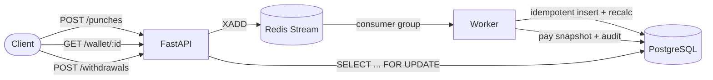

# LivePay

A small continuous payroll engine for Ontario that recalculates an employee's
gross and net pay on every clock-in/clock-out event and shows how much earned
pay they could withdraw right now.

> ⚠️ **Learning project — not a real payroll product.**
> LivePay was built to learn continuous payroll calculation and on-demand pay,
> inspired by Dayforce's continuous calculation and Dayforce Wallet. It is
> **not** tax advice, it is **not** certified, and it must not be used to pay
> real people. Tax logic targets **Ontario only** and uses the CRA T4127
> Payroll Deductions Formulas (2026 edition). Always verify against the CRA
> Payroll Deductions Online Calculator (PDOC).

## Status

🚧 Under construction. Built in phases; see `DEFENSE.md` for the design log.

- [x] Phase 0 — Scaffold (FastAPI, Postgres + Redis via Docker, pytest, ruff, CI)
- [x] Phase 1 — Domain models + migrations
- [x] Phase 2 — Gross pay (overtime, midnight-crossing, missing clock-outs)
- [ ] Phase 3 — Deductions (CPP/CPP2, EI, federal + Ontario tax) — *blocked on T4127 PDF*
- [ ] Phase 4 — PDOC verification tests — *22 input cases ready; awaiting PDOC run*
- [x] Phase 5 — Event pipeline (Redis Streams, worker, idempotency)
- [x] Phase 6 — Wallet (available balance, withdrawals, row-lock concurrency)
- [x] Phase 7 — Property-based tests (determinism, order-independence, invariants)
- [x] Phase 8 — README + architecture diagram
- [ ] Phase 9 — Optional React dashboard

## Architecture



A punch is accepted (202) and queued on a Redis Stream; a worker consumes it,
persists it idempotently, recalculates the current pay period's gross pay, and
writes a pay snapshot plus an audit-log entry. The wallet endpoints read the
latest snapshot and take a row lock when withdrawing so concurrent requests
can't overdraw.

## Stack

Python 3.12 · FastAPI · PostgreSQL · SQLAlchemy 2 + Alembic · Redis Streams ·
pytest + Hypothesis · ruff · Docker Compose · GitHub Actions.

## Quick start

Prerequisites: [uv](https://docs.astral.sh/uv/), Docker Desktop.

```bash
# 1. Start Postgres + Redis
docker compose up -d

# 2. Create the Python 3.12 environment and install deps
uv sync

# 3. Apply database migrations
uv run alembic upgrade head

# 4. Run the API (terminal 1)
uv run uvicorn livepay.main:app --reload

# 5. Run the worker (terminal 2)
uv run python -m livepay.worker

# 6. Check it's alive
curl http://localhost:8000/health   # -> {"status":"ok", ...}
```

> **Dev environment notes.** Postgres is mapped to host port **5433** (a native
> Postgres may already hold 5432). If your project directory is on OneDrive,
> keep the virtualenv outside it: `export UV_PROJECT_ENVIRONMENT=~/venvs/livepay`.

## Development

```bash
uv run ruff check .       # lint
uv run ruff format .      # format
uv run pytest             # tests (needs Postgres + Redis running)
```

Tests run against a dedicated `livepay_test` database (created automatically)
and Redis db 15, so they never touch dev data. Current suite: **27 tests**
covering schema constraints, gross-pay edge cases, the event pipeline, wallet
concurrency, and Hypothesis property tests. CI runs lint + tests on every push
with Postgres and Redis service containers.

## What's simplified vs. real payroll

- **Ontario only.** No other provinces/territories, no federal-only (e.g. QC
  has its own system).
- **Hourly employees only.** No salaried, no stat-holiday pay, no vacation pay,
  no benefits or taxable allowances, no shift premiums.
- **Deductions pending.** CPP/CPP2, EI, and income tax are gated on the T4127
  PDF and PDOC verification; until then `net_pay` is null and the wallet's
  available balance is 0.
- **Not certified.** Correctness is checked against PDOC, not CRA-certified.
- At-least-once event delivery (idempotency makes reprocessing safe); no
  dead-letter / pending-reclaim handling yet.

## What I'd build next

- Finish deductions (Phase 3) + PDOC verification (Phase 4) once the T4127
  numbers are in.
- Worker resilience: `XAUTOCLAIM` for stuck messages, a dead-letter stream.
- A readiness probe that checks Postgres/Redis (distinct from liveness).
- Multi-province support behind the existing tax-constants boundary.
- The optional React dashboard (Phase 9) showing live pay and the wallet.
